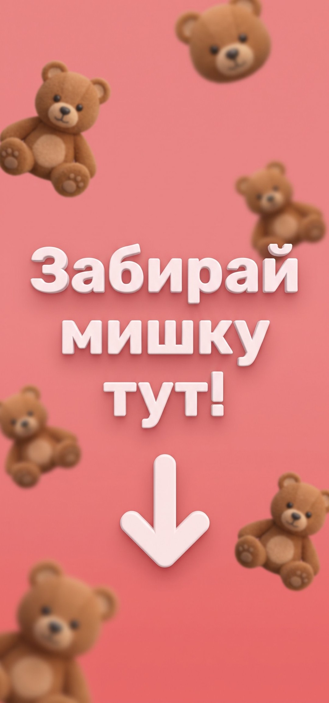

# ✨ Story Creator — [nuxokugiftbot](https://t.me)

**Веб-приложение для генерации и оформления историй в Telegram**

---

## 🌟 О проекте

Этот репозиторий создан для работы Telegram Mini App, который позволяет быстро и красиво создавать истории вместе с ботом **[nuxokugiftbot](https://t.me)**.

  

---

## 🚀 Как это работает?

| Шаг | Действие | Описание |
| :---: | :--- | :--- |
| **1️⃣** | **Запуск** | Перейди в бота **[nuxokugiftbot](https://t.me)** в Telegram |
| **2️⃣** | **Создание** | Открой мини-приложение и сгенерируй историю |
| **3️⃣** | **Публикация** | Сохрани результат и поделись им у себя в профиле |

---

## 📂 Структура репозитория

* 🌐 **`index.html`** — основная страница и интерфейс мини-приложения
* 🖼️ **`story.jpg`** — шаблон / фоновое изображение для историй
* 📄 **`README.md`** — описание проекта

---

### 👇 Перейти в бота 👇

